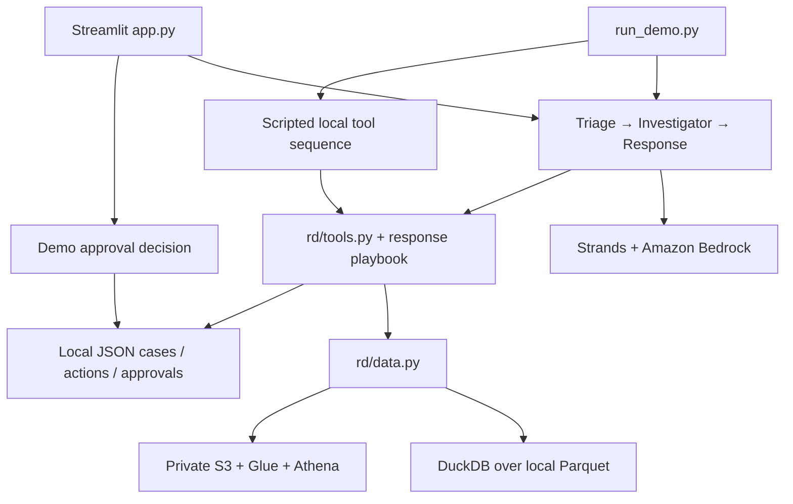

# Architecture and implementation status

`rd/agents/` contains the three agents. Each role owns its prompt and construction in `triage.py`, `investigator.py` or `response.py`. `shared.py` contains Bedrock configuration, trace hooks and complete JSON result parsing; `pipeline.py` coordinates the existing sequential flow. These remain separate Agent instances within one application process. The package exports preserve `from rd.agents import run_pipeline` and the AWS checker's `_model` import.

`rd/detect.py` supplies a statistical screen; it opens an investigation signal rather than proving a root cause. `rd/tools.py` exposes evidence and action tools; the playbook is read from `rd/policy/response_playbook.md`.

The shared configuration and scenarios now live in `rd/config.py` and `rd/scenarios.py`. Runtime state defaults to ignored `runtime/`, and local data to ignored `data/synthetic/`. Root `.env` supplies optional non-secret configuration without overriding terminal values.

## Verified locally

- Deterministic synthetic generation, four-table loading and expected quality/fit/transit signals.
- An isolated return and negative control stay below systemic signal thresholds.
- Tool authority checks and human approval requests run without AWS.
- The CLI offers `--scripted`; the UI identifies this mode as having no LLM.
- The early starter's simulation and tests remain runnable in `legacy/starter/`.

## Prototype boundaries

- Live Bedrock and Athena adapters exist; this reorganization does not verify account access or model behavior.
- All action tools record demo actions/requests in JSON. No real refund, stock hold, supplier message, customer outreach or timed follow-up is executed.
- DynamoDB, SNS and live retail adapters are future work. Approval identity is not authenticated; a local JSON lock is not a multi-process database.
- The replay date and data cache are process-global. Isolate runs; concurrent production users need request-scoped state.
- Official v2 uses strictly prior-day baselines and date-bounded return/exchange/transaction lookups. Undated fees, flags, final statuses and shipped quantities remain snapshot facts, not historical features; population return rates and unverified financial execution are unavailable. Legacy synthetic/v1 keeps its compatibility baseline.
- The optional Bedrock Guardrail is active only when configured. Tool outputs omit customer identifiers but can retain private business IDs.
- Statistics suggest hypotheses; they cannot establish a supplier/production-lot cause without those source fields. Business impact sliders are assumptions, not realized savings.

The reorganization preserves the existing thresholds and authority rules. It does not turn these demo boundaries into production capabilities.
