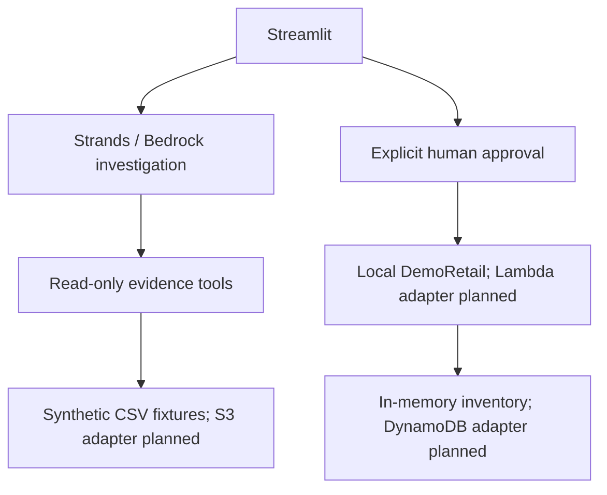

# Architecture and delivery status

The CLI demo is deterministic screening plus a simulated retail action. It is not an autonomous LLM loop. The separate Bedrock button invokes the implemented Strands evidence tools, but must be tested with the team's account and chosen model.

The model receives no approval or execution tool in this starter. The interface demonstrates an explicit QA approval before a hold. Production implementation must authenticate the approver in a trusted backend and persist decisions independently of the model.

An inventory read verifies that a hold executed; it does not prove future returns fell. A SKU/DC/shipping-cohort association is evidence for investigation, not confirmation that a supplier or factory caused the problem.

## Build gates

- Data: joins, quantities, observation windows, and missing cohort mapping are validated.
- Agent: real tools are called, competing hypotheses are considered, missing evidence leads to another query or escalation, and claims cite sources.
- AWS: approvals and idempotency are enforced by the backend; failures remain visible.
- Experience: evidence, actions, status, and verification are understandable without revealing hidden model reasoning.
- Evaluation: normal and insufficient-evidence cases stop safely; the fixed-alert baseline sees the same information at each replay time.

Business impact estimates must distinguish assumptions, simulated comparisons, and observed results. Holding costs, inspection, replacement fulfillment, and any lost contribution margin must be considered before claiming net savings.
