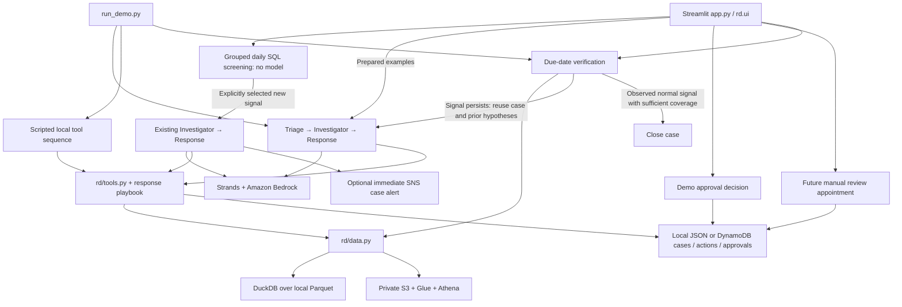

# Architecture and implementation status

`rd/agents/` contains the three agents. Each role owns its prompt and construction in `triage.py`, `investigator.py` or `response.py`. `shared.py` contains Bedrock configuration, trace hooks and complete JSON result parsing; `pipeline.py` coordinates the existing sequential flow. These remain separate Agent instances within one application process. The package exports preserve `from rd.agents import run_pipeline` and the AWS checker's `_model` import.

`rd/workflow.py` groups daily screening and serializes dated operations; `rd/ui.py` renders the three business pages. See [workspace semantics](UI_WORKSPACE.md). `rd/detect.py` supplies the shared statistical screen; it opens an investigation signal rather than proving a root cause. `rd/tools.py` exposes evidence and action tools; the playbook is read from `rd/policy/response_playbook.md`.

The shared configuration and scenarios now live in `rd/config.py` and `rd/scenarios.py`. Runtime state defaults to ignored `runtime/`, and local data to ignored `data/synthetic/`. Root `.env` supplies ignored local configuration without overriding terminal values. Temporary credentials, if stored there, stay local and must never be committed.

## Verified locally

- Deterministic synthetic generation, four-table loading and expected quality/fit/transit signals.
- An isolated return and negative control stay below systemic signal thresholds.
- Tool authority checks and human approval requests run without AWS.
- The CLI offers `--scripted`; the UI identifies this mode as having no LLM.
- Dated checks preserve cases, reject missing/sparse follow-up, reopen persistent signals and close observed normal signals. The prepared quality replay exercises both outcomes in isolated storage.
- `evaluation/compare_agents.py` compares the same six seeded cases using fixed tools or real Bedrock agents. SDK usage is captured when supplied; live-agent results require an actual live run.

## Prototype boundaries

- Live Bedrock and Athena adapters exist; this reorganization does not verify account access or model behavior.
- Business actions are demo records in the selected store. No real refund, stock hold, supplier message or customer outreach is executed. Follow-up checks run when triggered from the UI/CLI; no background cloud scheduler is deployed.
- The optional DynamoDB adapter persists demo records but reads and rewrites a namespace without cross-table transactions. Immediate SNS case alerts are optional and real when configured; email delivery is not established by SNS acceptance. Approval identity is not authenticated; neither backend is a multi-user production workflow.
- Dated operations share a process lock because the tools' replay date is process-global. The query cache is bounded. Separate application processes need separate case namespaces; production users need transactional, request-scoped state.
- Official v2 uses strictly prior-day baselines and date-bounded return/exchange/transaction lookups. Undated fees, flags, final statuses and shipped quantities remain snapshot facts, not historical features; population return rates and unverified financial execution are unavailable. Legacy synthetic/v1 keeps its compatibility baseline.
- The optional Bedrock Guardrail is active only when configured. Tool outputs omit customer identifiers but can retain private business IDs.
- Statistics suggest hypotheses; they cannot establish a supplier/production-lot cause without those source fields. Business impact sliders are assumptions, not realized savings.

The reorganization preserves the existing thresholds and authority rules. It does not turn these demo boundaries into production capabilities.
